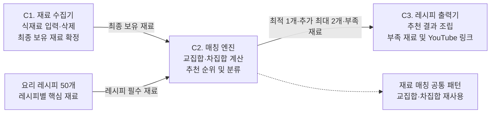

# 🍳 냉장고 재료 기반 레시피 추천 시스템

냉장고에 남은 식재료를 입력하면 당장 만들 수 있는 최적의 레시피와 추가 제안 레시피를 유튜브 검색 링크와 함께 제공하는 파이썬 파이프라인 시스템입니다. 배달 음식 고민과 비용 부담을 줄여주는 자취생 맞춤 솔루션을 제공합니다.

## 🎯 1. 프로젝트 목표

| 구분 | 핵심 목표 |
| :--- | :--- |
| **메뉴 고민 해결** | 사용자가 보유한 재료만으로 즉시 조리 가능한 요리 안내 |
| **스마트한 장보기** | 필수 재료가 1~2개 부족한 대안 레시피를 제안하여 남은 식재료 100% 활용 유도 |
| **에러 없는 파이프라인** | 외부 API 통신 장애 리스크를 없앤 고정 DB 및 자동 URL 매핑 적용 |

## ⚙️ 2. 시스템 구조 (Pipeline)

본 시스템은 3개의 독립적인 컴포넌트로 분리되어 순차적으로 동작합니다.

| 컴포넌트 | 기능 설명 (Core Logic) |
| :--- | :--- |
| **C1. 재료 수집기** | 불필요한 데이터(무게, 브랜드명)를 Drop하고 핵심 식재료 이름만 리스트로 입력받아 Keep |
| **C2. 매칭 엔진** | 50개의 고정 레시피 DB와 파이썬 집합(set)의 교집합(&), 차집합(-) 연산으로 빠르고 정확하게 대조 |
| **C3. 레시피 출력기** | 부족한 재료 개수를 기준으로 최적(0개)/대안(1~2개) 레시피를 분류하고, 유튜브 검색 URL 자동 조립(f-string) 출력 |

### 2.1 시스템 다이어그램

### 2.2 컴포넌트별 IPO (Input-Process-Output)

| 컴포넌트 | Input | Process | Output |
| :--- | :--- | :--- | :--- |
| **C1 재료 수집기** | 식재료 단어, X 삭제 이벤트 | 삭제한 재료 Drop, 최종 재료 Keep | 최종 보유 재료 목록 |
| **C2 매칭 엔진** | C1 출력, 레시피 50개 | 교집합·차집합 계산, 추천 후보 분류 | 최적 레시피, 추가 추천, 부족 재료 |
| **C3 레시피 출력기** | C2 추천 결과 | 안내 문구 구성, YouTube 검색 URL 생성 | 최종 추천 결과 |

### 2.3 데이터 흐름

| 흐름 ID | 출발 | 도착 | 전달 데이터 |
| :--- | :--- | :--- | :--- |
| **FLOW-01** | 사용자 | C1 | 식재료 입력·삭제 요청 |
| **FLOW-02** | C1 | C2 | 최종 보유 재료 목록 |
| **FLOW-03** | 레시피 데이터 | C2 | 레시피별 필수 재료 |
| **FLOW-04** | C2 | C3 | 추천 레시피 및 부족한 재료 |
| **FLOW-05** | C3 | 사용자 | 레시피 추천 결과 및 검색 링크 |

### 2.4 패턴 인식 및 재사용 기준

C2의 최적 레시피와 추가 레시피 계산은 동일한 재료 비교 구조를 사용합니다.

| 구분 | 처리 기준 |
| :--- | :--- |
| **반복 패턴** | 사용자 보유 재료와 레시피 필수 재료 비교 |
| **공통 계산** | 파이썬 집합(set)의 교집합·차집합 재사용 |
| **최적 레시피 분류** | 부족 재료 0개 |
| **추가 레시피 분류** | 부족 재료 1~2개 |
| **재사용 목적** | 추천 종류가 달라도 동일한 매칭 계산 기준 일괄 적용 |

## 🗄️ 3. 데이터 스키마

| 변수 이름 | 자료형 (Type) | 상세 설명 |
| :--- | :--- | :--- |
| **recipe_api_db** | `Dict` | 공공데이터포털(식약처) 기준 50개 요리를 필터링해 직접 구축한 정적 딕셔너리 |
| **user_ingredients**| `List` | 사용자가 입력한 보유 식재료 리스트 |
| **final_results** | `List` | 매칭 엔진을 거쳐 도출된 최종 결과 (요리명, 부족 재료, 유튜브 링크 포함) |

## 🛠️ 4. 개발 환경

| 구분 | 환경 및 기술 |
| :--- | :--- |
| **Language** | Python 3 |
| **Environment** | Google Colab |
| **Version Control** | Git / GitHub |
