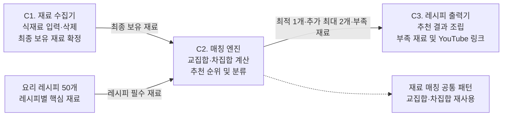

## 프로젝트 개요

### 1.1 문제 정의

> 냉장고에 남은 식재료가 있어도 해당 재료를 활용하여 만들 수 있는 요리를 
쉽게 판단하지 못하는 문제가 있다. 특히 요리 경험이 부족한 자취생은 메뉴를 결정하는 데 어려움을 겪고 배달음식을 선택하는 경우가 발생할 수 있다.
> 

> 본 프로젝트는 사용자가 보유한 식재료를 텍스트로 입력하면 조리 가능한 레시피를 추천하고, 추가 식재료 구매 시 만들 수 있는 요리를 함께 제공하여 식재료 활용과 메뉴 선택을 지원하는 프로그램을 개발하는 것을 목표로 한다.
> 

### 1.2 프로젝트 목표

| 구분 | 목표 |
| --- | --- |
| 식재료 입력 | 사용자가 식재료명을 입력·삭제하여 최종 보유 재료 목록 확정 |
| 레시피 비교 | 사용자 재료와 요리 50개의 필수 식재료 비교 |
| 최적 추천 | 부족한 필수 재료가 0개인 레시피 중 최적 1개 추천 |
| 추가 추천 | 부족한 필수 재료가 1~2개인 레시피 최대 2개 추천 |
| 추가 정보 | 레시피별 부족한 식재료 및 검수된 조리 팁 제공 |
| 조리 정보 접근 | 추천 요리명으로 YouTube 레시피 검색 결과 연결 |

### 1.3 사용자 및 기대 효과

| 항목 | 내용 |
| --- | --- |
| 주요 사용자 | 자취생 |
| 이용 상황 | 냉장고에 있는 식재료로 조리 가능한 메뉴를 찾는 상황 |
| 해결 문제 | 보유 재료와 조리 가능한 요리 사이의 정보 연결 부족 |
| 기대 효과 | 메뉴 선택 시간 단축, 요리 접근성 개선, 남은 식재료 활용, 불필요한 소비 감소 유도 |

### 1.4 성공 시나리오

사용자가 `계란, 양파, 스팸, 밥`을 입력할 경우 다음 동작을 목표로 한다.

| 단계 | 기대 결과 |
| --- | --- |
| 입력 | 계란, 양파, 스팸, 밥 등록 |
| 재료 확정 | 삭제되지 않은 네 가지 재료를 최종 목록으로 확정 |
| 매칭 | 해당 재료와 50개 레시피의 필수 재료 비교 |
| 최적 추천 | 스팸계란덮밥 |
| 선택 조리 팁 | 마요네즈를 넣으면 더 맛있어요! |
| 추가 추천 | 필수 재료가 1~2개 부족한 레시피 최대 2개 |
| 외부 링크 | 해당 레시피명으로 YouTube 검색 결과 이동 |

본 시나리오는 워크시트의 목표 사례다. 
실제 추천 결과는 검수된 레시피 데이터 및 확정된 추천 규칙에 따라 결정한다.

### 1.5 개발 범위

| 구분 | 기능 | 적용 여부 |
| --- | --- | --- |
| C1 | 식재료 입력·태그 생성·삭제·목록 확정 | 포함 |
| C2 | 레시피 필수 재료 비교 및 추천 순위 산정 | 포함 |
| C3 | 최적·추가 레시피 출력 및 외부 검색 연결 | 포함 |
| 데이터 | 자취생용 레시피 50개 구축 | 포함 |
| 데이터 | 필수·선택 재료 분류 및 검수 | 포함 |
| 화면 | 식재료 입력 및 추천 결과 화면 | 포함 |
| 제외 | 식재료 사진 촬영·인식 | 제외 |
| 제외 | 무게·브랜드·수량 기반 계산 | 제외 |
| 제외 | AI 기반 신규 레시피 생성 | 제외 |
| 제외 | 회원가입·로그인·개인 재료 영구 저장 | 제외 |
| 제외 | 장보기 주문 및 결제 | 제외 |
| 제외 | 개별 YouTube 영상 자동 수집 | 제외 |
| 추후 검토 | 알레르기·맵기·비건 조건 적용 | 초기 범위 제외 |

---

## 2. 시스템 구성도

### 2.1 시스템 구성

시스템은 식재료 수집기(C1), 매칭 엔진(C2), 레시피 출력기(C3)로 구성한다. 매칭 엔진은 검수된 레시피 50개 데이터를 함께 입력받아 추천 결과를 산출한다.

### 2.2 시스템 다이어그램



### 2.3 컴포넌트별 IPO

| 컴포넌트 | Input | Process | Output |
| --- | --- | --- | --- |
| C1 재료 수집기 | 식재료 단어, X 삭제 이벤트 | 삭제한 재료 Drop, 최종 재료 Keep | 최종 보유 재료 목록 |
| C2 매칭 엔진 | C1 출력, 레시피 50개 | 교집합·차집합 계산, 추천 후보 분류 | 최적 레시피, 추가 추천, 부족 재료 |
| C3 레시피 출력기 | C2 추천 결과 | 안내 문구 구성, YouTube 검색 URL 생성 | 최종 추천 결과 |

### 2.4 데이터 흐름

| 흐름 ID | 출발 | 도착 | 전달 데이터 |
| --- | --- | --- | --- |
| FLOW-01 | 사용자 | C1 | 식재료 입력·삭제 요청 |
| FLOW-02 | C1 | C2 | 최종 보유 재료 목록 |
| FLOW-03 | 레시피 데이터 | C2 | 레시피별 필수 재료 |
| FLOW-04 | C2 | C3 | 추천 레시피 및 부족한 재료 |
| FLOW-05 | C3 | 사용자 | 레시피 추천 결과 및 검색 링크 |

### 2.5 패턴 인식 및 재사용 기준

C2의 최적 레시피와 추가 레시피 계산은 동일한 재료 비교 구조를 사용한다.

| 구분 | 처리 |
| --- | --- |
| 반복 패턴 | 사용자 보유 재료와 레시피 필수 재료 비교 |
| 공통 계산 | 교집합·차집합 |
| 최적 레시피 분류 | 부족 재료 0개 |
| 추가 레시피 분류 | 부족 재료 1~2개 |
| 재사용 목적 | 추천 종류가 달라도 동일한 매칭 계산 기준 적용 |

---

## 3. 사용자 역할 및 용어 정의

### 3.1 사용자 역할

| 역할 | 설명 | 이용 범위 |
| --- | --- | --- |
| 일반 사용자 | 식재료를 입력하고 레시피를 추천받는 사용자 | 재료 입력·삭제, 추천 요청, 결과 확인, YouTube 검색 연결 |
| 데이터 관리 담당자 | 레시피 원천 정보를 수집·검수하는 프로젝트 담당자 | 레시피 선정, 재료 정규화, 데이터 오류 검수 |

초기 서비스에 관리자 웹 화면은 포함하지 않는다.

### 3.2 용어 정의

| 용어 | 정의 |
| --- | --- |
| 보유 재료 | 사용자가 소유하고 있다고 입력한 식재료 |
| 최종 보유 재료 | 삭제한 재료를 제외하고 추천 계산에 사용할 목록 |
| 필수 재료 | 해당 레시피의 조리 가능 여부 판정에 필요한 재료 |
| 선택 재료 | 조리 가능 여부를 결정하지 않는 추가 재료 |
| 교집합 | 사용자 보유 재료와 레시피 필수 재료에서 일치하는 집합 |
| 차집합 | 레시피 필수 재료 중 사용자가 보유하지 않은 재료 집합 |
| 일치율 | 레시피 필수 재료 수 대비 일치한 재료 수의 비율 |
| 최적 레시피 | 부족한 필수 재료가 0개인 후보 중 선정된 1순위 요리 |
| 추가 레시피 | 필수 재료가 1~2개 부족한 후보 |
| 식재료 표준화 | 같은 식재료의 다른 명칭을 동일한 기준으로 정리하는 과정 |
| 레시피 Master | 검수 완료 후 추천에 사용하는 50개 요리 기준 데이터 |

---

## 4. 기능 요구사항

### A. 식재료 입력 및 관리

| 요구사항 ID | 기능명 | 요구사항 | 우선순위 |
| --- | --- | --- | --- |
| FR-001 | 식재료 입력 | 사용자는 식재료명을 하나씩 입력할 수 있어야 한다. | 높음 |
| FR-002 | 식재료 태그 표시 | 입력한 식재료는 화면에 태그 형태로 표시되어야 한다. | 높음 |
| FR-003 | 식재료 삭제 | 사용자는 태그의 X 버튼으로 선택한 재료를 삭제할 수 있어야 한다. | 높음 |
| FR-004 | 최종 재료 확정 | 추천 요청 시 삭제되지 않은 식재료만 최종 목록으로 확정해야 한다. | 높음 |

### B. 레시피 매칭 및 분류

| 요구사항 ID | 기능명 | 요구사항 | 우선순위 |
| --- | --- | --- | --- |
| FR-005 | 레시피 데이터 조회 | 시스템은 검수된 50개 요리의 필수 재료 정보를 조회할 수 있어야 한다. | 높음 |
| FR-006 | 교집합 계산 | 사용자 보유 재료와 레시피 필수 재료의 일치 항목과 개수를 계산해야 한다. | 높음 |
| FR-007 | 차집합 계산 | 레시피 필수 재료 중 사용자가 보유하지 않은 항목과 개수를 계산해야 한다. | 높음 |
| FR-008 | 최적 레시피 선정 | 부족한 필수 재료가 0개인 요리 중 우선순위가 가장 높은 1개를 선정해야 한다. | 높음 |
| FR-009 | 추가 레시피 선정 | 부족한 필수 재료가 1~2개인 요리 중 우선순위가 높은 최대 2개를 선정해야 한다. | 높음 |

### C. 추천 결과 출력

| 요구사항 ID | 기능명 | 요구사항 | 우선순위 |
| --- | --- | --- | --- |
| FR-010 | 최적 레시피 출력 | 최적 레시피를 추천 결과 화면에 표시해야 한다. | 높음 |
| FR-011 | 추가 레시피 출력 | 추가 식재료가 필요한 레시피를 별도 영역에 표시해야 한다. | 높음 |
| FR-012 | 부족한 재료 안내 | 추가 추천 레시피별 부족한 필수 재료를 표시해야 한다. | 높음 |
| FR-013 | 조리 팁 출력 | 검수된 선택 재료 또는 조리 팁이 있는 경우 안내 문구를 표시해야 한다. | 중간 |
| FR-014 | YouTube 검색 연결 | 추천 요리명으로 YouTube 레시피 검색 결과 페이지에 이동할 수 있어야 한다. | 높음 |

### D. 데이터 및 공통 처리

| 요구사항 ID | 기능명 | 요구사항 | 우선순위 |
| --- | --- | --- | --- |
| FR-015 | 레시피 데이터 구축 | 자취생용 레시피 50개와 필수 재료를 구축해야 한다. | 높음 |
| FR-016 | 식재료 데이터 정제 | 원천 재료명에서 비교에 필요한 명칭을 추출·정리해야 한다. | 높음 |
| FR-017 | 중복 입력 처리 | 같은 식재료를 반복 입력해도 매칭에 중복 반영되지 않아야 한다. | 높음 |
| FR-018 | 추천 결과 없음 처리 | 최적·추가 추천이 존재하지 않는 경우 결과 없음 상태를 표시해야 한다. | 높음 |
| FR-019 | 입력 오류 처리 | 최종 보유 재료가 없는 경우 추천 요청을 제한해야 한다. | 높음 |
| FR-020 | 데이터 이용 불가 처리 | 검수된 레시피 데이터를 사용할 수 없는 경우 추천 처리를 중단하고 오류를 안내해야 한다. | 높음 |

---

## 5. 업무 규칙 및 예외 처리

### 5.1 추천 계산 기준

사용자 보유 재료 집합을 `U`, 특정 레시피의 필수 재료 집합을 `R`이라고 정의한다.

| 항목 | 계산 기준 |  |  |  |  |
| --- | --- | --- | --- | --- | --- |
| 일치 재료 | `U ∩ R` |  |  |  |  |
| 부족 재료 | `R - U` |  |  |  |  |
| 일치 재료 수 | ` | U ∩ R | ` |  |  |
| 부족 재료 수 | ` | R - U | ` |  |  |
| 필수 재료 일치율 | ` | U ∩ R | / | R | ` |

필수 재료가 0개인 레시피는 검수 오류로 분류하여 계산 대상에서 제외한다.

### 5.2 추천 분류

| 조건 | 추천 분류 |
| --- | --- |
| 부족한 필수 재료 0개 | 최적 레시피 후보 |
| 부족한 필수 재료 1개 | 추가 레시피 후보 |
| 부족한 필수 재료 2개 | 추가 레시피 후보 |
| 부족한 필수 재료 3개 이상 | 초기 추천 후보에서 제외 |

### 5.3 추천 우선순위 검토안

| 구분 | 1차 기준 | 2차 기준 | 최종 동점 기준 |
| --- | --- | --- | --- |
| 최적 레시피 | 일치 재료 수 내림차순 | - | 레시피 기준 식별값 오름차순 |
| 추가 레시피 | 필수 재료 일치율 내림차순 | 일치 재료 수 내림차순 | 레시피 기준 식별값 오름차순 |

동점 규칙은 동일 입력에 같은 결과를 제공하기 위한 검토안이며 팀 승인 후 확정한다.

### 5.4 필수·선택 재료 분류 기준

| 구분 | 분류 기준 |
| --- | --- |
| 필수 재료 | 해당 재료가 없으면 해당 레시피로 조리할 수 없다고 검수된 재료 |
| 선택 재료 | 해당 재료가 없어도 레시피를 조리할 수 있다고 검수된 재료 |
| 기본 양념 | 원천 레시피를 검수하여 필수 여부 판단 |
| 물 | 별도 입력 필요 여부 및 기본 보유 취급을 팀에서 결정 |
| 대체 식재료 | 초기 범위에 자동 대체 기능 포함하지 않음 |
| 알레르기 정보 | 초기 필터 미제공. 개인별 식품 안전성 보장 기능으로 표시하지 않음 |

### 5.5 정상·예외 흐름

| 구분 | 발생 조건 | 요구 처리 |
| --- | --- | --- |
| 정상 | 유효한 식재료 입력 | 식재료 태그 추가 |
| 정상 | 재료 삭제 | 해당 재료를 최종 목록에서 제외 |
| 정상 | 최적 후보 존재 | 최적 레시피 1개 표시 |
| 정상 | 추가 후보 1개만 존재 | 추가 레시피 1개만 표시 |
| 예외 | 입력 재료 없음 | 추천 요청 차단 |
| 예외 | 동일 식재료 반복 입력 | 중복 등록 또는 계산 방지 |
| 예외 | 잘못 입력한 재료 | 사용자가 X 버튼으로 삭제·재입력 가능 |
| 예외 | 미등록 식재료 | 재료 인식 불가 안내. 자동 오타 수정은 필수 기능 아님 |
| 예외 | 최적 후보 0개, 추가 후보 존재 | 최적 추천 없음과 추가 추천 표시 |
| 예외 | 최적·추가 후보 모두 없음 | 추천 가능한 레시피 없음 안내 |
| 예외 | 레시피 필수 재료 누락 | 해당 레시피 제외 |
| 장애 | 추천 데이터 이용 불가 | 정상 추천 결과로 표시하지 않고 오류 안내 |
| 외부 | YouTube 검색 결과 없음 | 특정 영상의 존재를 보장하지 않음 |

### 5.6 입력값 경계조건

| 검증 대상 | 최소 조건 | 최대 조건 | 상태 |
| --- | --- | --- | --- |
| 입력 재료 수 | 추천 시 1개 이상 |  | 최대 개수 미정 |
| 식재료명 길이 | 공백 제외 1자 이상 |  | 최대 길이 미정 |
| 동일 재료 개수 | 표준 재료 기준 1개로 계산 | 중복 없음 | 기준 정의 |
| 최적 추천 개수 | 0개 | 1개 | 확정 가능 |
| 추가 추천 개수 | 0개 | 2개 | 확정 가능 |
| 추가 추천 부족 재료 수 | 1개 | 2개 | 워크시트 기준 |
| 추천 레시피 데이터 | 50개 | 50개 | 구축 목표 |

입력 글자 수 및 재료 등록 최대 개수는 화면 설계와 실제 데이터 범위를 확인한 후 확정한다.

---

## 6. 비기능 요구사항

| 요구사항 ID | 분류 | 요구사항 | 검증 기준 |
| --- | --- | --- | --- |
| NFR-001 | 정확성 | 교집합·차집합 계산 결과가 실제 필수 재료 데이터와 일치해야 한다. | 검증용 입력과 기대 결과 비교 |
| NFR-002 | 일관성 | 동일한 입력과 동일한 데이터 버전에서는 같은 추천 결과를 제공해야 한다. | 반복 요청 결과 비교 |
| NFR-003 | 데이터 무결성 | 검수된 레시피에 중복 식별값 및 필수 재료 누락이 없어야 한다. | 승인 데이터 전체 검사 |
| NFR-004 | 사용성 | 사용자가 재료 입력·삭제 및 추천 결과를 확인할 수 있어야 한다. | 사용자 시나리오 시험 |
| NFR-005 | 접근성 | 입력창·삭제 버튼·추천 버튼·외부 링크를 키보드로 조작할 수 있어야 한다. | 키보드 조작 시험 |
| NFR-006 | 데이터 추적성 | 각 레시피의 출처와 검수 상태를 확인할 수 있어야 한다. | 데이터 기록 검사 |
| NFR-007 | 안정성 | 입력 오류·후보 없음·데이터 오류가 발생해도 상태에 맞는 안내를 제공해야 한다. | 예외 테스트 |
| NFR-008 | 데이터 복구 | 수집 실패 시 기존 검수 데이터가 손상되지 않아야 한다. | 실패·재실행 테스트 |
| NFR-009 | 보안 | API 인증정보와 사용자 입력값을 안전하게 처리해야 한다. | 인증키 노출 및 입력 검증 검사 |
| NFR-010 | 성능 | 50개 레시피 기준 추천 계산 성능을 측정해야 한다. | 실행 환경·목표 응답시간 확정 후 측정 |
| NFR-011 | 환경 호환성 | 확정된 사용자 실행 환경에서 핵심 기능이 동작해야 한다. | 개발 환경 확정 후 시험 |

### 6.1 기술 관련 비기능 요구사항

| 요구사항 ID | 요구사항 명세 | 적용 기술 |
| --- | --- | --- |
| NFR-TECH-01 | C1·C2·C3 컴포넌트를 독립적으로 검증할 수 있어야 한다. |  |
| NFR-TECH-02 | 레시피 및 식재료 데이터를 조회할 수 있어야 한다. |  |
| NFR-TECH-03 | 입력값과 레시피 데이터를 비교할 수 있는 집합 연산을 지원해야 한다. |  |
| NFR-TECH-04 | 사용자 입력 및 결과 출력에 필요한 화면 환경을 제공해야 한다. |  |
| NFR-TECH-05 | 외부 레시피 데이터 수집 및 검수 결과를 관리할 수 있어야 한다. |  |
| NFR-TECH-06 | 추천 결과에서 외부 검색 페이지로 연결할 수 있어야 한다. |  |
| NFR-TECH-07 | 개발 코드 및 데이터 변경 이력을 관리해야 한다. |  |
| NFR-TECH-08 | 개발 환경 및 운영 환경은 기술 선정 후 정의한다. |  |

---

## 7. 화면 목록

| 화면 ID | 화면명 | 주요 구성 요소 | 관련 요구사항 | 사용자 |
| --- | --- | --- | --- | --- |
| VIEW-01 | 식재료 입력 화면 | 입력창, 재료 태그, X 삭제 버튼, 추천 버튼 | FR-001~004, FR-017, FR-019 | 일반 사용자 |
| VIEW-02 | 레시피 추천 결과 화면 | 최적 레시피, 추가 추천, 부족 재료, 조리 팁, YouTube 검색 링크 | FR-010~014, FR-018 | 일반 사용자 |

### 7.1 VIEW-01 식재료 입력 화면

| 구성 요소 | 역할 |
| --- | --- |
| 식재료 입력창 | 재료명 입력 |
| 재료 추가 버튼 | 식재료 목록에 추가 |
| 재료 태그 | 등록된 재료 표시 |
| X 삭제 버튼 | 입력된 재료 삭제 |
| 레시피 추천 버튼 | 최종 목록 확정 및 추천 요청 |
| 오류 안내 영역 | 빈 입력·중복·미인식 재료 안내 |

### 7.2 VIEW-02 레시피 추천 결과 화면

| 구성 요소 | 역할 |
| --- | --- |
| 보유 재료 요약 | 매칭에 사용된 재료 표시 |
| 최적 레시피 영역 | 즉시 조리 가능한 레시피 표시 |
| 추가 제안 영역 | 부족한 재료가 있는 추천 요리 표시 |
| 부족 재료 안내 | 추가로 필요한 식재료 표시 |
| 조리 팁 | 검수된 선택 재료·조리 팁 표시 |
| YouTube 검색 버튼 | 추천 레시피명으로 검색 결과 이동 |
| 재료 수정 버튼 | 입력 화면 복귀 및 기존 입력 목록 수정 |
| 결과 없음 안내 | 추천 후보 부재 안내 |

### 7.3 사용자 화면 흐름

```
VIEW-01 식재료 입력
    ↓
재료 추가 및 삭제
    ↓
최종 보유 재료 확정
    ↓
레시피 매칭
    ↓
VIEW-02 추천 결과
    ├─ 최적 레시피
    ├─ 추가 레시피 및 부족한 재료
    ├─ YouTube 검색
    └─ 재료 수정 → VIEW-01
```

---

## 8. 데이터 요구사항 및 공식 원천

### 8.1 데이터 소스

| 구분 | 제공기관 | 데이터명 | 활용 목적 | 검증 상태 |
| --- | --- | --- | --- | --- |
| DATA-SRC-01 | 식품의약품안전처 | 조리식품의 레시피 DB `COOKRCP01` | 레시피명·재료 정보 수집 | 공식 명세·샘플 확인 |
| DATA-SRC-02 | 농림수산식품교육문화정보원 | 레시피 기본정보 | 요리 기본정보 보완 | 공식 데이터 목록 확인 |
| DATA-SRC-03 | 농림수산식품교육문화정보원 | 레시피 재료정보 | 요리별 재료 정보 보완 | 공식 데이터 목록 확인 |

**공식 원천 주소**

- 식품안전나라: https://www.foodsafetykorea.go.kr/api/openApiInfo.do?menu_grp=MENU_GRP31&menu_no=661&show_cnt=10&start_idx=1&svc_no=COOKRCP01
- 레시피 기본정보: https://www.data.go.kr/data/15057205/openapi.do
- 레시피 재료정보: https://www.data.go.kr/data/15058981/openapi.do

### 8.2 COOKRCP01 원천 필드

| 필드 | 데이터 | 활용 |
| --- | --- | --- |
| `RCP_SEQ` | 레시피 일련번호 | 원천 식별 |
| `RCP_NM` | 메뉴명 | 레시피명 |
| `RCP_PARTS_DTLS` | 재료 정보 | 재료 추출·검수 |
| `RCP_PAT2` | 요리 종류 | 분류 참고 |
| `MANUAL01`~`MANUAL20` | 조리 방법 | 재료 검수 참고 |
| `RCP_NA_TIP` | 저감 조리법 팁 | 조리 팁 활용 여부 검토 |

### 8.3 공식 샘플에서 확인한 레시피

| 원천 레시피 | 확인된 재료 예시 | 검토 사항 |
| --- | --- | --- |
| 칼륨 듬뿍 고구마죽 | 고구마, 설탕, 찹쌀가루, 물, 잣 | 필수·선택 재료 분리 |
| 누룽지 두부 계란죽 | 누룽지, 순두부, 달걀, 채소, 양념 | 복합 재료 문자열 정제 |
| 오색지라시 스시 | 밥, 달걀노른자, 버섯, 새우, 피망 등 | 자취생용 레시피 적합성 검토 |
| 두부 곤약 나물 비빔밥 | 두부, 곤약, 곡류, 나물 등 | 재료 접근성·조리 간편성 검토 |

해당 레시피는 공식 샘플에서 확인한 후보이며, 최종 50개 승인 목록에는 아직 포함 확정하지 않았다.

### 8.4 레시피 50개 선정 기준

| 검증 항목 | 승인 기준 |
| --- | --- |
| 데이터 수 | 서로 구별되는 요리 50개 |
| 요리명 | 누락 없는 레시피명 |
| 원천 | 출처 및 식별정보 확인 |
| 핵심 재료 | 레시피별 필수 재료 최소 1개 |
| 재료 검수 | 재료명 표준화 및 필수·선택 구분 |
| 중복 | 동일 레시피 중복 없음 |
| 조리 적합성 | 자취생의 일반적인 조리 환경에서 활용 가능한 요리로 선정 |
| 데이터 활용 | 원천 이용 조건 및 출처 표시 검토 |
| 품질 상태 | 검수 완료된 레시피만 추천 대상으로 사용 |

### 8.5 데이터 확보 및 검증 결과

| 검증 대상 | 결과 |
| --- | --- |
| 공식 레시피 데이터 존재 | 확인 |
| 요리명·재료 정보 필드 | 확인 |
| 공식 샘플 레시피 | 확인 |
| 별도 레시피 기본정보 원천 | 확인 |
| 별도 레시피 재료정보 원천 | 확인 |
| 50개 후보의 실제 수집 | 미완료 |
| 50개 필수·선택 재료 검수 | 미완료 |
| 50개 최종 승인 | 미완료 |
| API 인증키 기반 전체 수집 테스트 | 미완료 |
| 원천 간 중복 및 데이터 매핑 검증 | 미완료 |

### 8.6 원천 데이터 검수 절차

1. 공식 데이터 제공기관 및 이용 조건을 확인한다.
2. API 인증 및 샘플 응답을 검증한다.
3. 필요한 레시피 데이터를 수집한다.
4. 메뉴명과 원천 식별값을 기준으로 중복을 검사한다.
5. 자취생에게 사용할 요리 후보 50개를 선정한다.
6. 재료 정보를 분해하고 명칭을 정리한다.
7. 레시피별 필수·선택 재료를 검수한다.
8. 승인된 데이터에 출처·검수 상태를 기록한다.
9. 검수된 50개 데이터만 추천 계산에 사용한다.

---

## 9. WBS (Work Breakdown Structure)

| 대분류 | 중분류 | 세부 작업 | 관련 요구사항 | 담당 |
| --- | --- | --- | --- | --- |
| 1. 요구사항 | 1.1 문제 및 범위 | 워크시트·다이어그램 기반 요구사항 정리 | 전체 |  |
|  | 1.2 검수·승인 | 요구사항 체크리스트 검토 및 승인 | 전체 |  |
| 2. 데이터 | 2.1 API 검증 | 데이터 소스 및 활용 조건 확인 | FR-015 |  |
|  | 2.2 데이터 수집 | 레시피 후보 확보 | FR-015 |  |
|  | 2.3 전처리 | 중복·재료명 정리 | FR-016 |  |
|  | 2.4 데이터 검수 | 50개 요리 필수 재료 승인 | FR-015~016 |  |
| 3. 설계 | 3.1 기능 설계 | C1·C2·C3 상세 동작 정의 | FR-001~020 |  |
|  | 3.2 화면 설계 | 입력 및 결과 화면 설계 | VIEW-01~02 |  |
| 4. 개발 | 4.1 C1 | 식재료 입력·삭제·확정 | FR-001~004 |  |
|  | 4.2 C2 | 재료 비교 및 추천 분류 | FR-005~009 |  |
|  | 4.3 C3 | 추천 결과·검색 링크 출력 | FR-010~014 |  |
| 5. 검증 | 5.1 기능 검증 | 정상·예외·경계 테스트 | FR-001~020 |  |
|  | 5.2 통합 검증 | C1 → C2 → C3 연결 검증 | 전체 |  |
| 6. DB | 6.1 논리 설계 | 데이터 구조 및 관계 확정 | 데이터 요구사항 |  |
|  | 6.2 물리 설계·구축 | 선정한 DB 환경에서 구축 | 데이터 요구사항 |  |
|  | 6.3 연동 검증 | 데이터 적재·조회·무결성 시험 | FR-005~016 |  |
| 7. 배포 | 7.1 운영 환경 | 배포 방식 결정 후 진행 | 비기능 요구사항 |  |

---
